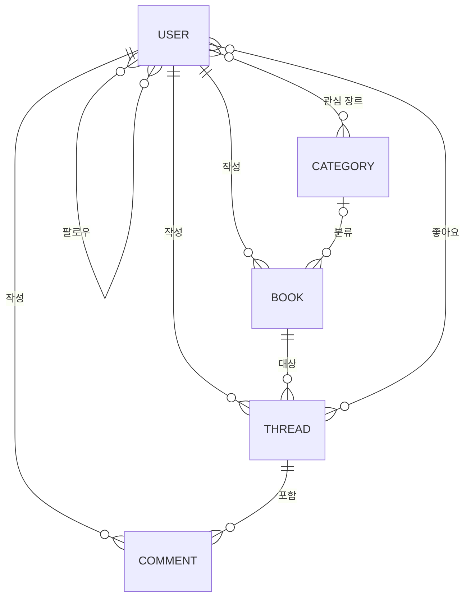

# 06-pjt: 관계형 DB 설계

**ThRead**는 도서를 등록하고, 읽은 뒤의 감상을 쓰레드(게시글)로 나누는 Django 도서 커뮤니티입니다.
도서를 등록하면 작가 정보를, 쓰레드를 작성하면 감상의 분위기를 담은 커버 이미지를 생성형 AI가 만들어 줍니다.

| 항목      | 내용                                                                             |
| --------- | -------------------------------------------------------------------------------- |
| 팀원      | 고은비(초기 프로젝트 구성과 기본 CRUD), 안재윤(이후 요구사항 구현과 산출물 정리) |
| 기술 스택 | Python 3.11, Django 5.2, Bootstrap 5.3, SQLite                                   |
| 외부 API  | 위키피디아 API, SSAFY GMS(gpt-5-nano, gpt-image-2)                               |
| 테스트    | `python manage.py test` 161개 통과 (외부 API는 모의 객체로 대체)               |

## 실행 방법

```bash
py -3.11 -m venv venv
venv\Scripts\activate
pip install -r requirements.txt
copy .env.example .env        # .env의 GMS_KEY에 본인 키 입력
python manage.py migrate
python manage.py seed_demo    # 관리자 계정과 샘플 데이터 생성
python manage.py runserver
```

접속 주소는 `http://127.0.0.1:8000/`입니다. `GMS_KEY`가 없어도 서비스는 동작하며, AI 생성 내용만 비어 있고 안내 메시지가 표시됩니다.

| 계정               | 비밀번호       | 용도                       |
| ------------------ | -------------- | -------------------------- |
| `admin`          | `1234`       | 관리자 페이지(`/admin/`) |
| `alex`, `sora` | `ssafy1234!` | 샘플 사용자                |

## 주요 기능

### 회원 (accounts)

- `AbstractUser`를 상속한 사용자 모델로 이메일, 성, 이름, 성별, 나이, 주간 평균 독서 시간, 연간 독서량, 프로필 사진을 저장합니다.
- 로그인, 로그아웃, 회원가입(가입 후 자동 로그인), 회원정보 수정, 회원탈퇴, 비밀번호 변경(변경 후 로그인 유지)을 제공합니다.
- 프로필 페이지에서 회원 정보, 작성한 쓰레드, 팔로워·팔로잉 수를 보여 주며, 다른 사용자는 팔로우하거나 취소할 수 있습니다.
- Navbar는 로그인 여부에 따라 바뀌고, 비로그인 상태에서는 데이터 생성 링크가 나타나지 않습니다.

### 도서와 쓰레드 (books)

- 도서와 쓰레드의 생성, 조회, 수정, 삭제를 제공합니다. 수정과 삭제는 작성자만 할 수 있으며, 그 외 요청은 403으로 거부합니다.
- 쓰레드 좋아요와 취소, 댓글 작성과 삭제를 제공합니다. 댓글 삭제 버튼은 작성자에게만 보입니다.
- 소설/시/희곡 등 7개 장르로 도서를 분류해 메인 페이지에서 필터링하고, 회원은 관심 장르를 여러 개 선택할 수 있습니다.

### 생성형 AI (심화)

- **작가 정보(F625):** 도서를 등록하면 저자 이름으로 위키피디아에서 소개와 사진을 찾고, gpt-5-nano가 작가 소개와 대표작을 JSON으로 만들어 저장합니다. 상세 페이지에 AI 생성 정보임을 안내합니다.
- **커버 이미지(F626):** 쓰레드를 작성하면 도서 제목, 저자, 감상의 감정을 분석해 키워드 5개를 뽑고, 키워드로 만든 프롬프트로 이미지를 생성해 `media/`에 저장합니다.
- **장애 격리:** AI 호출이 실패해도 도서와 쓰레드는 저장되고 경고만 표시합니다.

### 데이터 모델



### 비기능 요구사항

- **URL 구성(NF602):** 템플릿과 뷰는 `app_name`과 URL name만 사용합니다. URL 접두사를 바꿔도 링크가 따라가는지 테스트로 검증했습니다.
- **HTTP Method 허용(NF603):** 모든 뷰에 허용 메서드를 지정했고, 전체 URL에 대해 나머지 메서드가 405를 반환하는지 테스트로 검증했습니다.

## 명세와 다른 점

명세는 이미지 생성에 `dall-e-3`을 지정하지만, 현재 GMS가 `Model dall-e-3 is not available` (400)로 요청을 거부합니다. 그래서 GMS에서 호출이 확인된 `gpt-image-2`를 기본값으로 사용했습니다. GMS가 다시 지원하면 `.env`에 `IMAGE_MODEL=dall-e-3`만 추가하면 되며, 두 모델의 요청 형식 차이는 코드에서 처리합니다.

## 요구사항별 결과

실행 결과 칸의 숫자를 누르면 캡처 화면이 열립니다. 전체 캡처는 [산출물/실행결과](산출물/실행결과)에 있습니다.

| 번호  | 요구사항                   | 구분 | 커밋                     | 실행 결과                                                                                                                                                                                                                                                                                                                                   |
| ----- | -------------------------- | ---- | ------------------------ | ------------------------------------------------------------------------------------------------------------------------------------------------------------------------------------------------------------------------------------------------------------------------------------------------------------------------------------------- |
| F601  | 프로젝트 구성              | 필수 | `efab370`              | [1](산출물/실행결과/F601_1_main_page_anonymous.png) · [2](산출물/실행결과/F601_2_main_page_logged_in.png)                                                                                                                                                                                                                                    |
| F602  | accounts Model Class       | 필수 | `fee2d81`              | [1](산출물/실행결과/F602_admin_user_model.png)                                                                                                                                                                                                                                                                                               |
| F603  | accounts Form Class        | 필수 | `dba3862`              | [1](산출물/실행결과/F603_1_signup_form_validation.png)                                                                                                                                                                                                                                                                                       |
| F604  | books Model Class (Book)   | 필수 | `6fb0430`              | [1](산출물/실행결과/F604_admin_book_model.png)                                                                                                                                                                                                                                                                                               |
| F605  | books Model Class (Thread) | 필수 | `6efa86a`              | [1](산출물/실행결과/F605_admin_thread_model.png)                                                                                                                                                                                                                                                                                             |
| F606  | books Form Class           | 필수 | `1308343`              | [1](산출물/실행결과/F606_1_book_form_validation.png)                                                                                                                                                                                                                                                                                         |
| F607  | login                      | 필수 | `0083a03`              | [1](산출물/실행결과/F607_1_login_page.png) · [2](산출물/실행결과/F607_2_login_error.png) · [3](산출물/실행결과/F607_3_login_success_navbar.png)                                                                                                                                                                                              |
| F608  | logout                     | 필수 | `f9297be`              | [1](산출물/실행결과/F608_1_before_logout.png) · [2](산출물/실행결과/F608_2_after_logout_redirect_main.png)                                                                                                                                                                                                                                   |
| F609  | signup                     | 필수 | `a9bad8e`              | [1](산출물/실행결과/F609_1_signup_page.png) · [2](산출물/실행결과/F609_2_signup_success_redirect_main.png)                                                                                                                                                                                                                                   |
| F610  | profile                    | 필수 | `4cdcdb1`              | [1](산출물/실행결과/F610_1_own_profile.png) · [2](산출물/실행결과/F610_2_other_profile.png)                                                                                                                                                                                                                                                  |
| F611  | follow                     | 필수 | `1815ae5`              | [1](산출물/실행결과/F611_1_before_follow.png) · [2](산출물/실행결과/F611_2_after_follow.png)                                                                                                                                                                                                                                                 |
| F612  | update (회원정보)          | 필수 | `98ac3d1`              | [1](산출물/실행결과/F612_1_update_page_no_sensitive_fields.png) · [2](산출물/실행결과/F612_2_updated_redirect_main.png)                                                                                                                                                                                                                      |
| F613  | delete (회원탈퇴)          | 필수 | `f0ba96a`              | [1](산출물/실행결과/F613_1_own_profile_delete_button.png) · [2](산출물/실행결과/F613_2_deleted_redirect_main.png)                                                                                                                                                                                                                            |
| F614  | change_password            | 필수 | `a812ddc`              | [1](산출물/실행결과/F614_1_change_password_page.png) · [2](산출물/실행결과/F614_2_changed_still_logged_in_main.png)                                                                                                                                                                                                                          |
| F615  | index                      | 필수 | `2eb19d3`              | [1](산출물/실행결과/F615_index.png)                                                                                                                                                                                                                                                                                                          |
| F616  | create                     | 필수 | `d084899`              | [1](산출물/실행결과/F616_1_book_create_page.png) · [2](산출물/실행결과/F616_2_book_created_detail.png)                                                                                                                                                                                                                                       |
| F617  | detail                     | 필수 | `2bd3c45`              | [1](산출물/실행결과/F617_book_detail.png)                                                                                                                                                                                                                                                                                                    |
| F618  | update (도서)              | 필수 | `bc919d4`              | [1](산출물/실행결과/F618_book_update_prefilled.png)                                                                                                                                                                                                                                                                                          |
| F619  | delete (도서)              | 필수 | `b4ebdc8`              | [1](산출물/실행결과/F619_1_before_delete.png) · [2](산출물/실행결과/F619_2_deleted_redirect_main.png)                                                                                                                                                                                                                                        |
| F620  | thread_create              | 필수 | `3f7abb4`              | [1](산출물/실행결과/F620_1_thread_create_page.png) · [2](산출물/실행결과/F620_2_thread_created_detail.png)                                                                                                                                                                                                                                   |
| F621  | thread_detail              | 필수 | `d6443e6`              | [1](산출물/실행결과/F621_thread_detail.png)                                                                                                                                                                                                                                                                                                  |
| F622  | thread_update              | 필수 | `27932d6`              | [1](산출물/실행결과/F622_thread_update_prefilled.png)                                                                                                                                                                                                                                                                                        |
| F623  | thread_delete              | 필수 | `c4ff9cd`              | [1](산출물/실행결과/F623_1_before_delete.png) · [2](산출물/실행결과/F623_2_deleted_redirect_book_detail.png)                                                                                                                                                                                                                                 |
| F624  | like                       | 필수 | `daae3e7`              | [1](산출물/실행결과/F624_1_before_like.png) · [2](산출물/실행결과/F624_2_after_like.png)                                                                                                                                                                                                                                                     |
| F625  | 정보 생성 및 저장          | 심화 | `976103b`              | [1](산출물/실행결과/F625_author_info_generated.png)                                                                                                                                                                                                                                                                                          |
| F626  | 커버 이미지                | 심화 | `37b4963`              | [1](산출물/실행결과/F626_thread_cover_generated.png)                                                                                                                                                                                                                                                                                         |
| F627  | 쓰레드 댓글                | 심화 | `6edf397`              | [1](산출물/실행결과/F627_1_no_comments.png) · [2](산출물/실행결과/F627_2_comment_created_delete_only_own.png) · [3](산출물/실행결과/F627_3_comment_deleted.png)                                                                                                                                                                              |
| F628  | 카테고리                   | 심화 | `18caef1`              | [1](산출물/실행결과/F628_1_signup_select_genres.png) · [2](산출물/실행결과/F628_2_profile_shows_genres.png) · [3](산출물/실행결과/F628_3_book_create_select_category.png) · [4](산출물/실행결과/F628_4_book_detail_category.png) · [5](산출물/실행결과/F628_5_index_filter_science.png) · [6](산출물/실행결과/F628_6_index_filter_empty.png) |
| NF601 | Git 활용                   | 필수 | `964b15a`, `5f44a60` | [NF601_gitlab_commits.png](산출물/실행결과/NF601_gitlab_commits.png)                                                                                                                                                                                                                                                                         |
| NF602 | URL 구성                   | 필수 | `1e48b4e`              | [1](산출물/실행결과/NF602_1_books_named_url_patterns.png) · [2](산출물/실행결과/NF602_2_accounts_named_url_patterns.png)                                                                                                                                                                                                                     |
| NF603 | HTTP Method 허용           | 필수 | `48d4feb`              | [1](산출물/실행결과/NF603_get_on_post_only_view_405.png)                                                                                                                                                                                                                                                                                     |

## Git 협업 원칙 (NF601)

### 세운 원칙

- **브랜치:** `master` 단일 브랜치에서 작업합니다. 작업 전에 `git pull`로 최신 상태를 받습니다.
- **커밋 메시지:** `<요구사항 번호> <요구사항 이름>: <변경 요약>` 형식으로 작성합니다. 요구사항 번호가 없는 제출 작업은 명세의 절 번호를 씁니다(예: `1.6 프로젝트 결과`).
- **커밋 시점:** 요구사항 하나를 구현하고 테스트가 통과했을 때 커밋하고 바로 푸시합니다.
- **제외 파일:** `venv`, `__pycache__`, `db.sqlite3`, `media`, `.env`, 대외비 명세서 PDF는 커밋하지 않습니다.

### 브랜치별 용도

| 브랜치     | 용도                                    |
| ---------- | --------------------------------------- |
| `master` | 모든 요구사항의 개발과 제출 기준 브랜치 |

### 원칙 점검

- 전체 34개 커밋(README 정리 전 기준) 중 규칙을 세우기 전의 초기 커밋 `12f5c02`를 제외하고 메시지 형식을 지켰으며, 요구사항마다 커밋과 푸시를 반복했습니다.
- 단일 브랜치로 운영해 병합 충돌은 없었습니다.
- **발생한 문제와 원인:** 초기 커밋에 `__pycache__`, `db.sqlite3`, 대외비 PDF가 포함되어 있었습니다. 원인은 `.gitignore`에 `venv`만 있었던 것입니다. 이미 추적 중인 파일은 `.gitignore`에 추가해도 제외되지 않으므로 `git rm --cached`로 추적을 해제했습니다. 이 파일들은 과거 커밋에는 남아 있습니다. DB가 빠진 대신 `seed_demo` 명령어로 같은 계정과 샘플 데이터를 만들 수 있게 했습니다.

## 학습 내용

- **관계 설계:** 팔로우처럼 방향이 있는 자기 참조 M:N에는 `symmetrical=False`와 `related_name`이 필요합니다. 관계마다 삭제 정책도 달랐는데, 카테고리가 삭제되어도 도서는 남아야 하므로 `SET_NULL`을, 쓰레드는 도서 없이 의미가 없으므로 `CASCADE`를 썼습니다.
- **데이터 마이그레이션:** 장르 7개처럼 항상 있어야 하는 데이터는 수동 입력 대신 `RunPython` 마이그레이션에 두면 모든 환경에서 똑같이 만들어집니다.
- **인증과 세션:** 비밀번호를 바꾸면 세션 해시가 달라져 로그아웃되므로 `update_session_auth_hash`가 필요합니다.
- **데코레이터 순서:** `@login_required`가 바깥에 있으면 비로그인 GET 요청이 405가 아니라 로그인 페이지로 리다이렉트됩니다. `@require_POST`를 바깥에 두어 메서드 검사를 먼저 하도록 통일했습니다.
- **ModelForm의 부작용:** `instance=request.user`로 폼을 만들면 검증 과정에서 `request.user` 값이 바뀝니다. 중복 아이디를 입력했을 때 Navbar에 다른 사용자의 프로필 링크가 나타나는 문제를 `refresh_from_db()`로 해결했습니다.
- **외부 API 연동:** 응답 형식은 항상 어긋날 수 있다고 보고 JSON 파싱과 값의 타입을 검증했습니다. 저자를 수정할 때 이전 저자의 정보가 남지 않도록 다시 생성하는 처리도 필요했습니다.
- **프롬프트 작성:** 프롬프트에 예시 값(`"한국어 2~3문장 작가 소개"`)을 넣었더니 모델이 그 문구를 그대로 돌려줬습니다. 예시 값 대신 필드 설명을 쓰자 해결됐습니다. `reasoning_effort`를 `minimal`로 낮추면 빠르지만 존재하지 않는 작품명을 지어내는 경우가 있어 `low`로 올렸습니다.
- **Git:** `.gitignore`는 아직 추적하지 않는 파일에만 적용됩니다. 이미 올라간 파일은 `git rm --cached`로 해제해야 하고, 과거 기록에는 그대로 남기 때문에 처음부터 올바르게 설정하는 것이 중요합니다.

## 느낀 점

처음에는 모델 몇 개와 CRUD면 금방 끝날 줄 알았는데, 관계가 늘어날수록 작은 결정들이 서로 연결되어 있다는 것을 알게 됐습니다. 회원이 탈퇴하면 작성한 도서와 그 도서에 달린 다른 사람의 쓰레드까지 함께 지워지는 것처럼, `on_delete` 옵션 하나가 서비스의 동작을 결정했습니다. 관계형 DB 설계가 단순히 테이블을 나누는 일이 아니라 서비스 규칙을 정하는 일이라는 점이 가장 크게 남았습니다.

가장 인상 깊었던 것은 테스트의 한계였습니다. 모의 객체로 만든 테스트는 모두 통과했는데, 실제로 API를 호출하자 모델이 프롬프트의 예시 문구를 그대로 돌려주고, 작품명을 틀리게 만들고, 명세에 지정된 `dall-e-3`은 아예 호출되지 않았습니다. 테스트는 제가 예상한 상황만 확인해 준다는 것을, 그래서 실제 환경에서 직접 실행해 보는 과정이 꼭 필요하다는 것을 배웠습니다. "AI가 생성한 정보로, 정확하지 않을 수 있습니다"라는 안내 문구가 왜 요구사항에 들어 있는지도 결과를 보고 나서야 이해했습니다.

생성형 AI를 개발 과정에 활용하면서도 같은 점을 느꼈습니다. 코드를 빠르게 얻을 수는 있어도, 그 결과가 요구사항을 정말 만족하는지는 테스트와 브라우저 실행으로 확인해야 했습니다. 다음 프로젝트에서는 처음부터 요구사항별로 테스트를 함께 쓰고, `.gitignore`를 첫 커밋 전에 챙기는 것부터 시작하려고 합니다.
